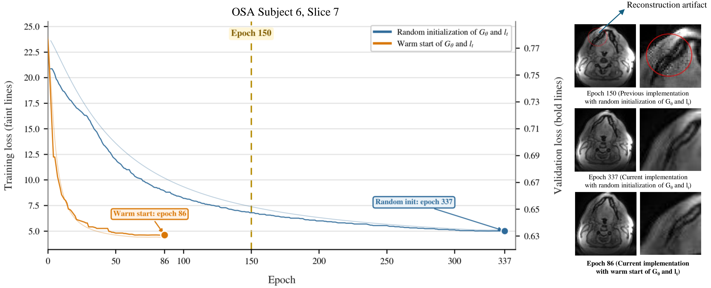

# Adjacent-Slice Warm-Starting Accelerates Self-Supervised Dynamic Upper-Airway MRI Reconstruction in Obstructive Sleep Apnea

**ISMRM 2027** (abstract #04347, submitted) | University of Iowa


> Md Shahin Ali<sup>1</sup>, Mathews Jacob<sup>2</sup>, Wahidul Alam<sup>3</sup>, Aygun Asgarli<sup>4</sup>, Douglas Van Daele<sup>5</sup>, Junjie Liu<sup>4</sup>, Sajan Goud Lingala<sup>1,6</sup>
>
> <sup>1</sup>Roy J. Carver Department of Biomedical Engineering, University of Iowa, USA<br>
> <sup>2</sup>Department of Electrical and Computer Engineering, University of Virginia, USA<br>
> <sup>3</sup>GE HealthCare, (United States), USA<br>
> <sup>4</sup>Department of Neurology, University of Iowa, USA<br>
> <sup>5</sup>Department of Otolaryngology, University of Iowa, USA<br>
> <sup>6</sup>Department of Radiology, University of Iowa, USA

---

## Overview

Self-supervised variational manifold learning reconstructs multi-slice dynamic upper-airway MRI from undersampled spiral k-space: a CNN generator maps a per-frame latent vector to an image, and the generator and the latent vectors are fitted jointly to one patient's own k-space, with no ground-truth training data. Training every slice to convergence, rather than for a fixed number of epochs, removes residual artifacts but increases computation.

This repository **warm-starts** the slices instead. The middle slice (slice 6) of the 11-slice stack is trained from random initialization; every other slice starts from its adjacent slice's optimized generator weights and latent vectors, propagating outward in both directions (6→7→…→11 and 6→5→…→1), with all parameters remaining trainable.

The repository is set up to run on **one subject**.

## Method

**Figure 1.** (a) Self-supervised training of one slice. (b) Warm-started transfer outward from the source slice.


| experiment | what it does |
|---|---|
| **EXP 1** `E1_scratch` | every slice trained from random initialization (10 generator-only epochs, then joint training) |
| **EXP 2** `E2_chain` | slice 6 from scratch; every other slice warm-started from its neighbour's weights and latent vectors at that neighbour's convergence point; nothing frozen |
| **Isolation** (optional) | slice 7 from slice 6 with (B) weights only or (C) latent only; (A) weights + latent is EXP 2 |

- **Self-supervised split:** 5% of the samples in each spiral readout are held out as validation data (drawn with a right-skewed distribution along the readout). The validation loss is never backpropagated.
- **Convergence:** a reduce-on-plateau scheduler on the validation loss (patience 20, factor 0.1, threshold 0.001) reduces the learning rate when the validation loss has not improved by more than 0.1% for 20 epochs. Convergence is the first such reduction; epoch counts and validation losses are read there, from the minimum-validation-loss model. Training continues to the second reduction (700-epoch ceiling) so that a "drop 2" model also exists.
- **Learning rates:** warm-started slices use the same rates as the baseline's joint-training stage (generator 2e-5, latent 4e-4); they skip the baseline's 10-epoch generator-only warm-up. Baseline epoch counts start at joint training and do not include those 10 epochs.

## Results

Across six OSA patients (slice 7 each), joint transfer of generator weights and latent vectors reduced the mean number of epochs to convergence from 347.3 to 142.8, a mean patient-wise speedup of **2.46×** (range 1.64–3.53×). The warm-start/baseline validation-loss ratio was 0.9650 ± 0.0136, below 1 in every patient, indicating better agreement with the held-out k-space. Transferring the generator weights alone (163.0 epochs) gave most of the benefit, more than transferring the latent vectors alone (183.5 epochs).

**Figure 2.** Patient 6, slice 7. Training to convergence removes an artifact present at the previous fixed 150-epoch stopping point; random initialization needed 337 epochs, warm start 86 (3.9× fewer).



**Figure 3.** Anterior–posterior temporal cuts, baseline vs warm start, six patients; absolute differences ×5.


**Figure 4.** Baseline and warm-start reconstructions across all 11 slices of one patient, with absolute differences ×5.


[Full-resolution video (MP4)](Figures/fig4_all_slices.mp4)

**Figure 5.** Initialization ablation (six patients, slice 7): (a) epochs to convergence, (b) epoch speedup, (c) validation-loss ratio.


Figures 3 and 4 are made by the scripts in this repository. Figures 2 and 5 were assembled from the training logs (`ForPlottingLossStats_*.pth` and the timing CSVs).

## Repository Structure

```
├── config.py                                 # the only file you edit: path to your data file
├── run_pipeline.py                           # EXP 1 (baseline) then EXP 2 (warm start)
├── run_experiment.py                         # one experiment: 1 = baseline, 2 = warm start
├── run_isolation.py                          # ablation: weights-only vs latent-only transfer
├── gen_STORM_transfer.py                     # training driver (baseline / transfer / isolate)
├── optimize_gen_sub.py                       # self-supervised training loop and stopping rule
├── dataOpNewKbnufft.py                       # data loading, coil compression, ESPIRiT, NUFFT
├── generator_320.py                          # CNN generator
├── latentVariable.py                         # per-frame latent vectors
├── runlog.py                                 # per-slice timing log
├── make_temporal_cut_ap.py                   # Figure 3: anterior-posterior temporal cut
├── make_baseline_vs_warmstart_diff_video.py  # Figure 4: 11-slice video with |difference| and SER
├── plot_baseline_vs_warmstart_multi.py       # epochs + validation loss, baseline vs warm start
├── stats_utils.py                            # shared helpers for the figure scripts
├── espirit/                                  # ESPIRiT coil maps (git submodule)
├── ismrmrdtools/                             # ISMRMRD Python tools (included, own license)
├── Figures/                                  # abstract figures shown above
└── requirements.txt
```

## Installation

A CUDA-capable GPU is required (the NUFFT operators run on the GPU).

```bash
git clone --recursive https://github.com/md-shahin-ali/warmstart-airway-mri.git
cd warmstart-airway-mri

conda create -n warmstart python=3.10 -y
conda activate warmstart

# 1. PyTorch matching your CUDA version: https://pytorch.org/get-started/locally/
# 2. everything else
pip install -r requirements.txt
```

`espirit/` is a git submodule pointing to [mikgroup/espirit-python](https://github.com/mikgroup/espirit-python); `--recursive` downloads it. If you already cloned without it, run `git submodule update --init`. `ismrmrdtools/` is included from [ismrmrd-python-tools](https://github.com/ismrmrd/ismrmrd-python-tools) under its own license (see `ismrmrdtools/LICENSE`).

## Data

One MATLAB v7.3 `.mat` file per subject, containing:

| variable | type    | shape                                    |
|----------|---------|------------------------------------------|
| `kdata`  | complex | `[nReadouts, nCoils, nArms, nSlices]`    |
| `k`      | complex | `[nReadouts, nArms]` (kx + i·ky, normalized to [-0.5, 0.5]) |
| `dcf`    | real    | `[nReadouts, nArms]`                     |

The pipeline uses 11 slices and 800 frames of 3 spiral arms each, so the file needs at least 2400 arms. If yours has fewer, lower `nFramesDesired` in `run_experiment.py` and `run_isolation.py` to at most `nArms / 3`.

The patient data used in this work are not distributed with this repository.

## Usage

**1. Set your data path.** Open `config.py` and paste the full path to your `.mat` file:

```python
DATA_FILE = os.environ.get('WARMSTART_DATA_FILE',
                           '/home/you/data/subject01/subject01.mat')
SUBJECT = 'subject01'
```

Or leave `config.py` alone and set `export WARMSTART_DATA_FILE=/path/to/subject01.mat`. To use a GPU other than the first, set `export RECON_DEVICE=cuda:1`.

**2. Reconstruct.**

```bash
python -u run_pipeline.py | tee pipeline.log      # baseline, then warm start, all 11 slices
python -u run_isolation.py | tee isolation.log    # optional ablation, slice 7
```

**3. Make figures.** Outputs go to `<data stem>_analysis/` next to your data file.

```bash
python make_temporal_cut_ap.py 7                  # Figure 3, slice 7
python make_baseline_vs_warmstart_diff_video.py   # Figure 4, MP4 + GIF
python plot_baseline_vs_warmstart_multi.py        # epochs + validation loss, slice 7
```

`plot_baseline_vs_warmstart_multi.py` has a `SUBJECTS` dictionary at the top; add `label: path` entries to also get the multi-subject aggregate. Difference maps are amplified ×5 (`DIFF_SCALE`), with their color scale tied to the image brightness.

## Outputs

Everything is written next to your data file, in folders that start with its name (`subject01` here):

| location | contents |
|---|---|
| `subject01_<slice>.pickle` | per-slice data cache (later runs read this instead of the `.mat`) |
| `subject01_60d/weights_…_<zero-based slice>_…_<run>/` | `ForPlottingLossStats_*.pth`: loss curves, stopping epochs, learning-rate drops, model state |
| `subject01_RECONS_60d/results_…_<run>_<slice>thSlice_…/` | `Recon_<slice>thSlice_800frms.mat`: reconstruction, `Recon120` = frames × 120 × 120 × {real, imag} |
| `…_<run>_drop1_<slice>thSlice_…/` | the same, for the model at the first learning-rate drop |
| `subject01_SOURCEWEIGHTS_slice6.pth` | slice-6 model reused by `run_isolation.py` |
| `timing_logs/<run>_timing.csv` | per-slice training time and epochs |
| `subject01_analysis/` | figures and videos |

Slice numbers are 1-based everywhere except the `weights_…` folder names, which use the zero-based index.

## Citation

```
Ali MS, Jacob M, Alam W, Asgarli A, Van Daele D, Liu J, Lingala SG.
Adjacent-slice warm-starting accelerates self-supervised dynamic upper-airway MRI
reconstruction in obstructive sleep apnea. ISMRM 2027, abstract #04347 (submitted).
```

The underlying self-supervised reconstruction method:

```
Ali MS, Alam W, Jacob M, Priya S, Van Daele D, Liu J, Lingala SG.
Improved upper-airway collapse imaging in obstructive sleep apnea using self-supervised
spiral variational manifold learning. Magn Reson Med. 2026.
```

## Acknowledgments

This work was supported by NIH NHLBI grant R01 HL173483 and was conducted on an MRI instrument funded by NIH S10 instrumentation grant 1S10OD025025-01.

## License

MIT, see [LICENSE](LICENSE). `ismrmrdtools/` and `espirit/` keep their own licenses.
