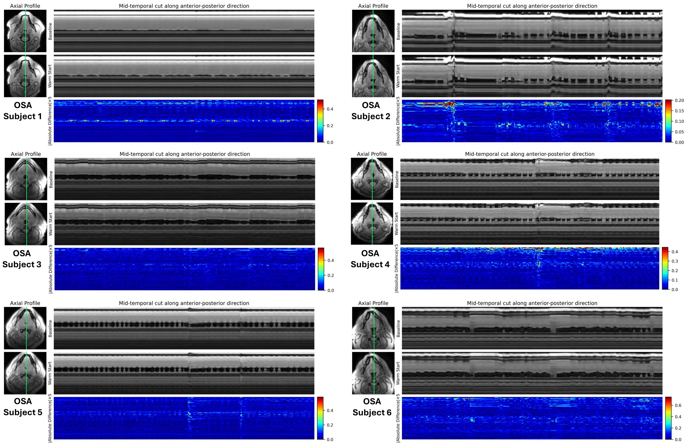
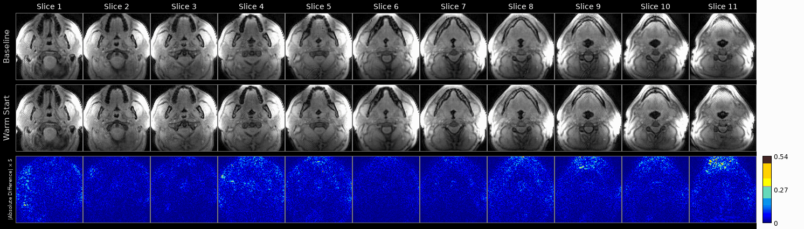
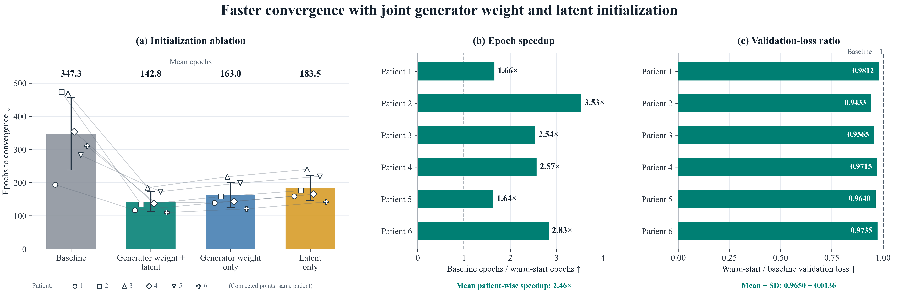

# Warm-started self-supervised reconstruction of multi-slice dynamic upper-airway MRI

This repository reconstructs multi-slice dynamic upper-airway MRI from undersampled spiral k-space with a **self-supervised generative manifold model**: a CNN generator `G` maps a per-frame latent vector `z(t)` to an image, and `G` and `z(t)` are fitted jointly to the measured k-space of one subject. No training data or ground truth is needed.

Each slice is normally fitted from scratch, and training every slice to convergence is expensive. This code **warm-starts** the slices instead: the middle slice (slice 6) is fitted from scratch, then the fit walks outward slice by slice (6→7→…→11 and 6→5→…→1), each slice starting from its neighbour's optimized generator weights and latent vectors, with all parameters still trainable.

This is the code for the ISMRM 2027 abstract *Adjacent-Slice Warm-Starting Accelerates Self-Supervised Dynamic Upper-Airway MRI Reconstruction in Obstructive Sleep Apnea* (see [Citation](#citation)). The repository is set up to run on **one subject**.

## Results (ISMRM abstract, six OSA patients)

Across six patients (slice 7 each), warm-starting both the generator weights and the latent vectors reduced the mean number of epochs to convergence from 347.3 to 142.8, a mean patient-wise speedup of **2.46×** (range 1.64–3.53×). The warm-start/baseline validation-loss ratio was 0.9650 ± 0.0136, below 1 in every patient, meaning the warm-started fit agreed better with the held-out k-space. Transferring the generator weights alone (163.0 epochs) gave most of the benefit, more than transferring the latent alone (183.5 epochs).

**Figure 1.** (a) Self-supervised training of one slice: k-space split into training and validation subsets; a CNN generator maps per-frame latent vectors to images. (b) Warm-started transfer outward from the source slice.


**Figure 2.** Patient 6, slice 7. Training to convergence removes an artifact present at the previous fixed 150-epoch stopping point; random initialization needed 337 epochs, warm start 86 (3.9× fewer).


**Figure 3.** Anterior–posterior temporal cuts, baseline vs warm start, six patients; absolute differences ×5.



**Figure 4.** Baseline and warm-start reconstructions across all 11 slices of one patient, with absolute differences ×5.



[Full-resolution video (MP4)](figures/fig4_all_slices.mp4)

**Figure 5.** Initialization ablation (six patients, slice 7): (a) epochs to convergence, (b) epoch speedup, (c) validation-loss ratio.



Figures 3 and 4 are made by the scripts in `analysis/` (see [Figures](#figures)). Figures 2 and 5 were assembled from the training logs (`ForPlottingLossStats_*.pth` and the timing CSVs described under [Outputs](#outputs)).

## Repository layout

```
config.py              <- the only file you edit: path to your data file
run_pipeline.py        <- EXP 1 (baseline) then EXP 2 (warm start), back to back
run_experiment.py      <- one experiment: `python run_experiment.py 1` or `2`
run_isolation.py       <- optional ablation: weights-only vs latent-only warm start
recon/                 <- reconstruction engine
    gen_STORM_transfer.py   training driver (baseline / transfer / isolate modes)
    optimize_gen_sub.py     self-supervised training loop and stopping rule
    dataOpNewKbnufft.py     data loading, coil compression, ESPIRiT, NUFFT operators
    generator_320.py        CNN generator
    latentVariable.py       latent trajectory z(t)
    runlog.py               per-slice timing log
analysis/              <- figures from saved results (no GPU needed)
    make_temporal_cut_ap.py                  Figure 3 (anterior-posterior temporal cut)
    make_baseline_vs_warmstart_diff_video.py Figure 4 (11-slice video with |difference| and SER)
    plot_baseline_vs_warmstart_multi.py      epochs + validation loss, baseline vs warm start
    stats_utils.py                           shared helpers
figures/               <- abstract figures shown in this README
```

## Installation

A CUDA-capable GPU is required (the NUFFT operators run on the GPU).

```bash
git clone https://github.com/<your-username>/<this-repo>.git
cd <this-repo>

conda create -n warmstart python=3.10 -y
conda activate warmstart

# 1. PyTorch matching your CUDA version: https://pytorch.org/get-started/locally/
# 2. everything else
pip install -r requirements.txt

# 3. ESPIRiT coil-map estimation (not on PyPI)
git clone https://github.com/mikgroup/espirit-python recon/espirit
```

Optional: `coilEst='inati'` or `'walsh'` also needs `pip install git+https://github.com/ismrmrd/ismrmrd-python-tools.git`. The default (`'espirit'`) does not.

## Data format

One MATLAB v7.3 `.mat` file per subject, containing:

| variable | type    | shape                                    |
|----------|---------|------------------------------------------|
| `kdata`  | complex | `[nReadouts, nCoils, nArms, nSlices]`    |
| `k`      | complex | `[nReadouts, nArms]` (kx + i·ky, normalized to [-0.5, 0.5]) |
| `dcf`    | real    | `[nReadouts, nArms]`                     |

The pipeline uses 11 slices and 800 frames of 3 spiral arms each, so the file needs at least 2400 arms. If yours has fewer, lower `nFramesDesired` in `run_experiment.py` and `run_isolation.py` to at most `nArms / 3`.

The data used in the original work are patient data and are not distributed with this repository.

## Configure

Open `config.py` and paste the full path to your data file:

```python
DATA_FILE = os.environ.get('WARMSTART_DATA_FILE',
                           '/home/you/data/subject01/subject01.mat')
SUBJECT = 'subject01'
```

Alternatively, leave `config.py` alone and set environment variables:

```bash
export WARMSTART_DATA_FILE=/home/you/data/subject01/subject01.mat
export WARMSTART_SUBJECT=subject01
```

To use a GPU other than the first one: `export RECON_DEVICE=cuda:1`.

## Run

```bash
# Reconstruction: EXP 1 (baseline) then EXP 2 (warm start), all 11 slices each
python -u run_pipeline.py | tee pipeline.log

# Optional ablation (after the pipeline): weights-only vs latent-only warm start, slice 7
python -u run_isolation.py | tee isolation.log

# Figures (see below)
python analysis/make_temporal_cut_ap.py 7
```

Training is long: 11 slices × 2 experiments, each slice trained until convergence. The original runs used one GPU and requested 250 GB of system memory on a cluster node. On a cluster, wrap `python -u run_pipeline.py` in your scheduler's job script.

### Protocol

Both experiments use the same stopping rule. A reduce-on-plateau scheduler on the self-supervised validation loss (patience 20, factor 0.1, threshold 0.001) reduces the learning rate when the validation loss has not improved by more than 0.1% for 20 epochs. **Convergence** is the first such reduction: the epoch counts and validation losses in the figures are read there, from the minimum-validation-loss model up to that point. Training continues to the second reduction (700-epoch ceiling) so that a "drop 2" model also exists, and reconstructions are saved for both.

Warm-started slices use the same learning rates as the baseline's joint-training stage (generator 2e-5, latent 4e-4); the only difference is that they skip the baseline's 10-epoch generator-only warm-up (2e-4). Baseline epoch counts are counted from the start of joint training, so they do not include those 10 warm-up epochs.

| experiment | what it does |
|---|---|
| **EXP 1** `E1_scratch` | every slice trained from random initialization (10 generator-only epochs, then joint training) |
| **EXP 2** `E2_chain` | slice 6 from scratch; every other slice warm-started from its neighbour's weights and latent at that neighbour's first learning-rate reduction; nothing frozen |
| **Isolation** (optional) | slice 7 from slice 6 with (B) weights only or (C) latent only; (A) weights + latent is EXP 2 |

The self-supervised loss holds out 5% of the samples in each spiral readout (drawn with a right-skewed distribution along the readout) as validation data. That held-out loss is what selects the best model and drives the stopping rule.

## Figures

Run after `run_pipeline.py`. Outputs go to `<data stem>_analysis/` next to your data file.

```bash
python analysis/make_temporal_cut_ap.py 7                    # Figure 3: A-P temporal cut, slice 7
python analysis/make_baseline_vs_warmstart_diff_video.py     # Figure 4: 11-slice MP4 + GIF
python analysis/plot_baseline_vs_warmstart_multi.py          # epochs + validation loss, slice 7
```

`plot_baseline_vs_warmstart_multi.py` has a `SUBJECTS` dictionary at the top. With one subject it plots that subject; add more `label: path` entries to also get the multi-subject aggregate (mean epochs and mean validation-loss ratio).

Difference maps are amplified ×5 (`DIFF_SCALE`), and their color scale is tied to the image brightness, so changing `DIFF_SCALE` visibly changes the maps.

## Outputs

Everything is written **next to your data file**, in folders that start with its name (`subject01` here):

| location | contents |
|---|---|
| `subject01_<slice>.pickle` | per-slice data cache (later runs read this instead of the `.mat`) |
| `subject01_60d/weights_…_<zero-based slice>_…_<run>/` | `ForPlottingLossStats_*.pth`: loss curves, stopping epochs, learning-rate drops, model state |
| `subject01_RECONS_60d/results_…_<run>_<slice>thSlice_…/` | `Recon_<slice>thSlice_800frms.mat`: final reconstruction, `Recon120` = frames × 120 × 120 × {real, imag}, plus a preview PNG |
| `…_<run>_drop1_<slice>thSlice_…/` | the same, for the model at the first learning-rate drop |
| `subject01_SOURCEWEIGHTS_slice6.pth` | slice-6 model reused by `run_isolation.py` |
| `timing_logs/<run>_timing.csv` | per-slice training time and epochs |
| `subject01_analysis/` | figures and videos from `analysis/` |

Slice numbers are 1-based everywhere except the `weights_…` folder names, which use the zero-based index.

## Acknowledgments

Supported by NIH NHLBI grant R01 HL173483. Data were acquired on an MRI instrument funded by NIH S10 instrumentation grant 1S10OD025025-01. QDMRI Lab, Roy J. Carver Department of Biomedical Engineering, University of Iowa.

## Citation

If you use this code, please cite:

> Ali MS, Jacob M, Alam W, Asgarli A, Van Daele D, Liu J, Lingala SG. Adjacent-slice warm-starting accelerates self-supervised dynamic upper-airway MRI reconstruction in obstructive sleep apnea. ISMRM 2027, abstract #04347 (submitted).

The underlying self-supervised reconstruction method:

> Ali MS, Alam W, Jacob M, Priya S, Van Daele D, Liu J, Lingala SG. Improved upper-airway collapse imaging in obstructive sleep apnea using self-supervised spiral variational manifold learning. Magn Reson Med. 2026.
